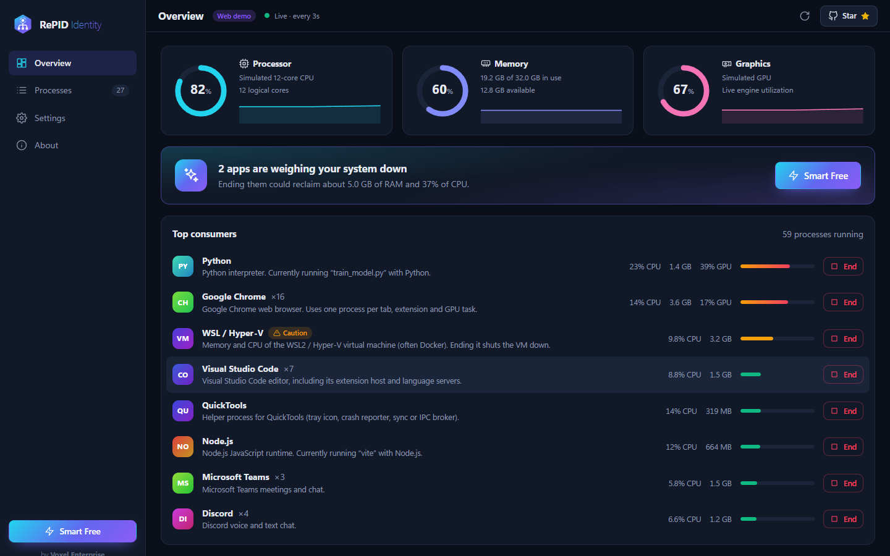
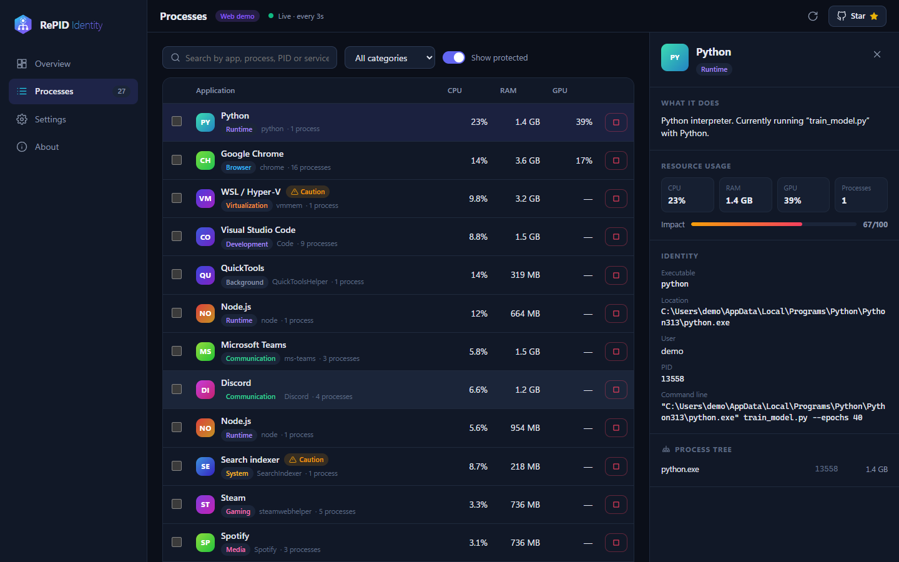
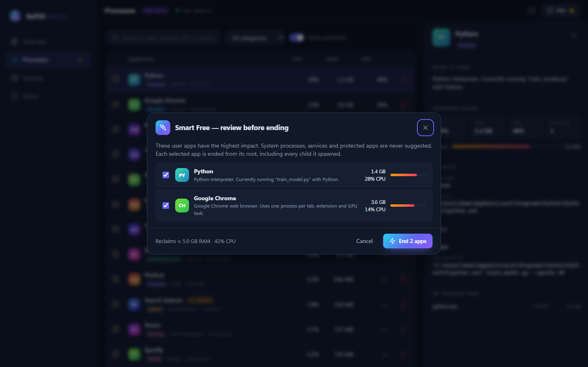

<div align="center">


# RePID Identity

**Descubre qué hace cada proceso. Libera tu equipo desde la raíz.**

App de escritorio gratuita y de código abierto para **Windows, macOS y Linux** que explica en lenguaje humano qué está haciendo cada proceso y servicio de tu equipo, y finaliza los más pesados *junto con todo lo que crearon* para recuperar CPU, RAM y GPU de forma segura.

[](LICENSE)
[](https://github.com/rellytechgame/repid-identity/releases/latest)
[](https://github.com/rellytechgame/repid-identity/releases)
[](https://github.com/rellytechgame/repid-identity/actions/workflows/ci.yml)
[](https://github.com/rellytechgame/repid-identity/stargazers)
[](CONTRIBUTING.md)

[**Descargar**](https://github.com/rellytechgame/repid-identity/releases/latest) ·
[**Demo web**](https://repid-identity-demo.vercel.app) ·
[**Sitio web**](https://repid-identity.vercel.app) ·
[**Reportar un error**](https://github.com/rellytechgame/repid-identity/issues/new/choose) ·
[**English**](README.md)

<br />



</div>

---

> ⭐ **Si RePID te ahorra tiempo, dale una estrella al repositorio.** Las estrellas son la forma en que otras personas descubren el proyecto: toma un segundo y ayuda muchísimo.

## ¿Por qué RePID Identity?

El Administrador de tareas, el Monitor de actividad o `top` te dicen *que* `node.exe`, `svchost.exe` o `Google Chrome Helper (Renderer)` está consumiendo recursos. No te dicen **qué es, por qué se está ejecutando ni cómo eliminarlo correctamente**:

- Finalizar un proceso de Chrome deja otros 30 en ejecución.
- Finalizar el proceso de un servicio solo hace que el administrador de servicios lo reinicie.
- Finalizar el proceso del sistema equivocado cierra tu sesión o cuelga el equipo.

RePID (*Re*-identificar el *PID*) resuelve eso: **identifica** cada proceso, lo **agrupa** con la aplicación a la que pertenece, lo **explica** en tu idioma y **finaliza todo el árbol desde la raíz**, haciendo imposible tocar algo que rompa tu sistema.

## Funciones

| | |
|---|---|
| 🧠 **Motor de identidad** | Combina un catálogo de más de 70 apps y componentes del sistema, el script que ejecuta un intérprete (`node vite`, `python train_model.py`), los servicios alojados, la ruta de instalación y los metadatos del editor del ejecutable. |
| 🌳 **Finalización desde la raíz** | Finaliza la app y cada hijo que creó, empezando por el supervisor para que no pueda relanzarlos. Primero `SIGTERM` ordenado; `SIGKILL` solo para los que sobreviven (POSIX). |
| ✨ **Liberación inteligente** | Una puntuación de impacto 0–100 combina CPU, RAM y GPU y sugiere qué cerrar, sin incluir nunca procesos del sistema, servicios ni lo que hayas protegido. |
| 📈 **CPU · RAM · GPU en vivo** | Medidores con historial, uso por aplicación y GPU por proceso (contadores del motor de GPU en Windows, `nvidia-smi` en el resto). |
| ⚙️ **Consciente de servicios** | Detecta servicios de Windows, unidades systemd y agentes launchd, y los **detiene** mediante su administrador. |
| 🛡️ **Red de seguridad** | Protección en tres niveles (Protegido / Precaución / Seguro) aplicada dentro del motor y verificada otra vez justo antes de cada acción. |
| 🌍 **Multiidioma** | Español e inglés incluidos. Agregar un idioma es añadir **un archivo JSON**. |
| 🔒 **100 % local** | Sin cuentas, sin telemetría, sin servidores. |

## Capturas

| Entiende qué hace un proceso | Liberación inteligente |
|---|---|
|  |  |

## Descarga e instalación

Descarga el instalador para tu sistema desde la [**última versión**](https://github.com/rellytechgame/repid-identity/releases/latest):

| Sistema | Paquete | Notas |
|---|---|---|
| **Windows 10/11** | Instalador `.exe` o portable | x64 y ARM64. Ejecuta como administrador para gestionar procesos de otros usuarios y servicios (o usa *Ajustes → Reiniciar como administrador*). |
| **macOS 12+** | `.dmg` | Apple Silicon e Intel. |
| **Linux** | `.AppImage`, `.deb`, `.rpm` | Los servicios del sistema se detienen con polkit (`pkexec`) cuando hace falta. |

## Compatibilidad

| Plataforma | Estado | Motivo |
|---|---|---|
| Windows · macOS · Linux | ✅ Completa | Procesos, servicios, metadatos y GPU por proceso donde el controlador lo permite. |
| Web | 🟡 Demo | Los navegadores no pueden ver los procesos del sistema. La [demo web](https://repid-identity-demo.vercel.app) usa la misma interfaz y lógica con un equipo simulado. |
| Android / iOS | ❌ No es posible | Los sistemas móviles aíslan cada app y prohíben ver o finalizar procesos de otras. Una versión móvil no podría hacer su trabajo, por eso no la publicamos. |

## Seguridad

| Nivel | Ejemplos | Comportamiento |
|---|---|---|
| 🔴 **Protegido** | `System`, `csrss`, `lsass`, `svchost`, `kernel_task`, `launchd`, `systemd`, RePID, lo que agregues | Nunca se finaliza; la interfaz lo deshabilita **y** el motor lo rechaza. |
| 🟠 **Precaución** | `explorer`, `vmmem`, `Finder`, `pipewire` | Requiere una confirmación explícita. |
| 🟢 **Seguro** | Apps de usuario | El diálogo muestra el árbol completo y la memoria que se liberará. |

Más detalles en [SECURITY.md](SECURITY.md) y [docs/ARCHITECTURE.md](docs/ARCHITECTURE.md).

## Desarrollo

```bash
git clone https://github.com/rellytechgame/repid-identity.git
cd repid-identity
npm ci
npm run dev          # App de escritorio con recarga en caliente
npm run dev:web      # Interfaz en el navegador con datos simulados
npm test             # Pruebas unitarias
npm run dist         # Instaladores en release/
```

Requisitos: Node.js ≥ 20. La tabla completa de scripts está en el [README en inglés](README.md#development).

## Idiomas

¿Quieres RePID en tu idioma? Sigue la [guía de traducción](docs/ADDING_A_LANGUAGE.md): copia `en.json`, tradúcelo y abre un pull request. La app lo detecta automáticamente.

## Contribuir

Toda contribución es bienvenida: código, un proceso que falta en el catálogo, una traducción o un reporte de error. Empieza por [CONTRIBUTING.md](CONTRIBUTING.md).

## Apoya el proyecto

RePID Identity es gratis, sin anuncios, sin venta de datos y **nunca** tendrá funciones de pago. Las donaciones financian la firma de código (certificado de Windows y cuenta de Apple Developer), el mantenimiento, el catálogo y las traducciones.

| Nivel | Monto | Recibes |
|---|---|---|
| ☕ Café | 3 USD | Agradecimiento público en las notas de la próxima versión |
| 🚀 Impulsor | 10 USD | Tu nombre en el muro de colaboradores (app, sitio web y [SUPPORTERS.md](SUPPORTERS.md)) |
| 💎 Patrocinador | 25 USD | Nombre **con enlace** · voto en la hoja de ruta · prioridad en tus reportes |
| 🏢 Empresa | 100 USD | Logo en este README, el sitio web y la pantalla *Acerca de* durante 12 meses · canal de contacto directo |

<div align="center">

[](https://paypal.me/REPLACE_WITH_YOUR_PAYPAL_ME)

</div>

Escribe tu nombre o usuario de GitHub en la nota de PayPal para acreditarte (se aplica manualmente en 7 días).

## Licencia y créditos

Publicado bajo la [Licencia MIT](LICENSE) © 2026 Voxel Enterprise.

<div align="center">
<br />
<sub>Diseñado y desarrollado por</sub><br />
<a href="https://github.com/rellytechgame">
  <picture>
    <source media="(prefers-color-scheme: dark)" srcset="assets/brand/voxel-logo-light.png" />
    
  </picture>
</a>
</div>
