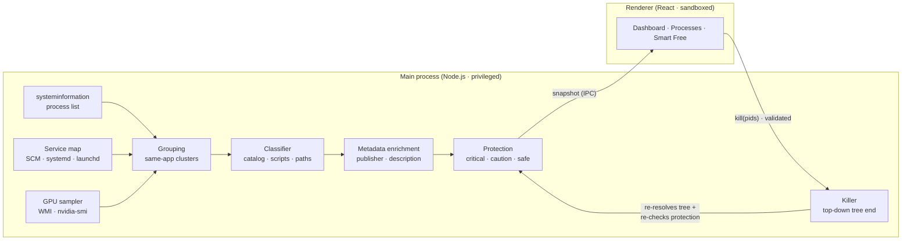

<div align="center">


# RePID Identity

**Know what every process does. End resource hogs from the root.**

A free, open-source desktop app for **Windows, macOS and Linux** that explains — in plain language — what every process and service on your computer is doing, and ends the heavy ones *together with everything they spawned*, to reclaim CPU, RAM and GPU safely.

[](LICENSE)
[](https://github.com/rellytechgame/repid-identity/releases/latest)
[](https://github.com/rellytechgame/repid-identity/releases)
[](https://github.com/rellytechgame/repid-identity/actions/workflows/ci.yml)
[](https://github.com/rellytechgame/repid-identity/stargazers)
[](CONTRIBUTING.md)
[](docs/ADDING_A_LANGUAGE.md)

[**Download**](https://github.com/rellytechgame/repid-identity/releases/latest) ·
[**Web demo**](https://repid-identity-demo.vercel.app) ·
[**Website**](https://repid-identity.vercel.app) ·
[**Report a bug**](https://github.com/rellytechgame/repid-identity/issues/new/choose) ·
[**Español**](README.es.md)

<br />


</div>

---

> ⭐ **If RePID saves you time, please star the repository.** Stars are how other people discover the project — it takes one second and helps a lot.

## Table of contents

- [Why RePID Identity?](#why-repid-identity)
- [Features](#features)
- [Screenshots](#screenshots)
- [Download & install](#download--install)
- [Platform support](#platform-support)
- [How it works](#how-it-works)
- [Safety model](#safety-model)
- [Performance mode](#performance-mode)
- [Startup manager](#startup-manager)
- [Deep cleanup](#deep-cleanup)
- [Privacy](#privacy)
- [Development](#development)
- [Project structure](#project-structure)
- [Languages](#languages)
- [Roadmap](#roadmap)
- [Contributing](#contributing)
- [Support the project](#support-the-project)
- [License & credits](#license--credits)

## Why RePID Identity?

Task Manager, Activity Monitor and `top` tell you *that* `node.exe`, `svchost.exe` or `Google Chrome Helper (Renderer)` is using resources. They don't tell you **what it is, why it's running, or how to get rid of it properly**:

- Ending one Chrome process leaves 30 others running.
- Ending a service's process just makes the service manager restart it.
- Ending the wrong system process logs you out or crashes the machine.

RePID (*Re*-identify the *PID*) closes that gap: it **identifies** every process, **groups** it with the application it belongs to, **explains** it in your language and **ends the whole tree from the root** — while making it impossible to touch anything that would break your system.

## Features

| | |
|---|---|
| 🧠 **Identity engine** | Combines a curated catalog of 70+ apps and OS components, the script an interpreter runs (`node vite`, `python train_model.py`), hosted services, install location and the executable's own publisher metadata to explain each process in plain language. |
| 🌳 **Root-level termination** | Ends an app and every child it spawned, supervisor first so it can't respawn them. Graceful `SIGTERM` first, `SIGKILL` only for survivors (POSIX). |
| ✨ **Smart Free** | A 0–100 impact score blends CPU, RAM and GPU and suggests what to close — never system processes, services or anything you protected. You review and confirm. |
| 📈 **Live CPU · RAM · GPU** | Gauges with history, per-application usage and per-process GPU utilization (Windows GPU engine counters, NVIDIA `nvidia-smi` elsewhere). |
| ⚙️ **Service-aware** | Detects Windows services, systemd units and launchd agents, and **stops** them through their manager instead of killing processes that would come back. |
| 🛡️ **Safety net** | Three-tier protection (Protected / Caution / Safe) enforced inside the engine, re-checked against fresh data right before every action. |
| 🚀 **Performance mode** | One-click profiles (Gaming, Focus, Render/build, Custom) that make background apps **yield CPU** to what you're using: below-normal priority plus Windows 11 **EcoQoS** (Task Manager's green leaf), and optionally above-normal priority for one focus app. Nothing is closed; everything is restored on stop or when RePID exits. |
| ⏻ **Startup manager** | Every program that opens at sign-in (Registry Run keys, Startup folders, Microsoft Store apps, logon scheduled tasks · LaunchAgents and login items · XDG autostart) with its real name, publisher and **live measured impact**. Disable reversibly with the OS's own mechanism, see what will happen first, and restore everything RePID changed in one click. |
| 🧹 **Deep cleanup** | Temp files, system temp, update cache, Recycle Bin/Trash, DNS cache, package-manager caches and the **cache, history and cookies of every browser** (Chrome, Edge, Firefox, Brave, Opera, Opera GX, Vivaldi, Chromium, Safari). Every item says *exactly what will happen* before you delete it; irreversible items need explicit confirmation. Passwords, bookmarks and documents are never touched. |
| 🔑 **Full privileges** | Windows builds run as administrator (UAC prompt at launch) to end any process, stop services and clean system folders. macOS/Linux ask for your password only for the actions that need it (one prompt per action). Critical processes stay blocked regardless. |
| 🌍 **Multilingual** | Spanish and English built in. Adding a language is adding **one JSON file** — the UI discovers it automatically. |
| 🎨 **Polished UX** | Dark/light/system themes, keyboard accessible, reduced-motion aware, native-feeling title bar on every OS. |
| 🔒 **100% local** | No accounts, no telemetry, no servers. |

## Screenshots

| Understand what a process does | Smart Free suggestions |
|---|---|
|  |  |
| **Deep cleanup with clear consequences** | **Your language, your rules** |
|  |  |

## Download & install

Grab the installer for your system from the [**latest release**](https://github.com/rellytechgame/repid-identity/releases/latest):

| OS | Package | Notes |
|---|---|---|
| **Windows 10/11** | `RePID-Identity-x.y.z-win-x64.exe` (installer), `…-portable.exe` | x64 and ARM64. Requests administrator rights at launch (UAC) so it can end any process, stop services and clean system folders. |
| **macOS 12+** | `RePID-Identity-x.y.z-mac-arm64.dmg` / `-x64.dmg` | Apple Silicon and Intel. |
| **Linux** | `.AppImage`, `.deb`, `.rpm` | System services are stopped through polkit (`pkexec`) when required. |

> [!NOTE]
> Until code-signing certificates are funded, Windows SmartScreen and macOS Gatekeeper may warn on first launch. See [Support the project](#support-the-project) — signing is the first thing donations pay for.

## Platform support

| Platform | Status | Why |
|---|---|---|
| Windows | ✅ Full | Processes, services (SCM), per-process GPU, elevation via UAC. |
| macOS | ✅ Full | Processes, launchd agents, bundle metadata. Per-process GPU only with NVIDIA tooling. |
| Linux | ✅ Full | Processes, systemd units (system & user), polkit elevation, NVIDIA per-process GPU. |
| Web | 🟡 Demo | Browsers cannot see OS processes. The [web demo](https://repid-identity-demo.vercel.app) runs the same UI and engine logic on a simulated computer. |
| Android / iOS | ❌ Not possible | Mobile OSes sandbox each app and forbid inspecting or ending other apps' processes. A mobile build could not do its job, so we don't ship one. |

## How it works



1. **Sample** — every few seconds the engine reads the process list, services and GPU counters (expensive lookups run in the background and are cached).
2. **Group** — processes are clustered into applications by walking up same-named ancestors; interpreters are keyed by the script they run, so `node vite` and `node tsserver` stay separate.
3. **Identify** — each group is classified (catalog → interpreter script → hosted service → Chromium/Electron role → updater/helper naming → system path → install folder → executable metadata).
4. **Score** — `impact = 45% CPU (saturates at 25%) + 40% RAM (saturates at 15%) + 15% GPU (saturates at 30%)`.
5. **Act** — on confirmation, the engine re-scans, resolves the full descendant tree itself, re-checks protection, ends parents before children, waits for a graceful exit and force-kills survivors.

See [docs/ARCHITECTURE.md](docs/ARCHITECTURE.md) for details.

## Safety model

| Tier | Examples | Behaviour |
|---|---|---|
| 🔴 **Protected** | `System`, `csrss`, `lsass`, `svchost`, `kernel_task`, `launchd`, `WindowServer`, `systemd`, `Xorg`, RePID itself, anything you add | Never ended. The UI disables the action **and** the engine refuses it. |
| 🟠 **Caution** | `explorer`, `vmmem`, `SearchIndexer`, `Finder`, `Dock`, `pipewire`, `NetworkManager` | Requires ticking an explicit acknowledgement. |
| 🟢 **Safe** | User applications | Confirmation dialog shows the whole tree and the memory it frees. |

Electron hardening: `contextIsolation`, `sandbox`, no `nodeIntegration`, strict CSP in production, IPC sender verification, schema validation of every IPC payload, external links restricted to fixed URLs, no shell string interpolation (all commands use `execFile` with argument arrays; paths reach PowerShell through environment variables). Report vulnerabilities via [SECURITY.md](SECURITY.md).

## Performance mode

Performance mode never ends a process. It changes **scheduling priority only**, and only for apps classified as safe:

| Profile | Yields CPU (pre-selected) | Never pre-selected |
|---|---|---|
| 🎮 Gaming | Browsers, cloud sync, updaters, office apps, IDEs, background helpers | Voice chat, overlays, launchers, media, running scripts/containers, unknown apps (it might be the game) |
| 🎯 Focus | Game launchers, updaters, background helpers | Your work apps |
| 🛠️ Render / build | Browsers, chat, launchers, media, sync, updaters, office | Your editor, renderer or build |
| ⚙️ Custom | Nothing — you choose | — |

- **Efficiency**: below-normal priority (`nice 10` on macOS/Linux) plus **EcoQoS** on Windows 11. A user's stronger manual choice (e.g. "Low") is never overridden.
- **Priority app**: above-normal only. "High" and "Realtime" are never used — they can starve input and audio. Windows only (raising priority needs root elsewhere).
- New processes an app starts later (new browser tabs) are adjusted automatically.
- Every change is recorded with its original value and restored on **Restore all**, when the selection changes, and when RePID quits. Pids are re-checked against the process name before restoring, so a reused pid is never touched.
- OS components, services, security software and anything marked *caution* keep their priority — enforced in the main process, not just hidden in the UI.

## Startup manager

| Source | How RePID disables it | Admin |
|---|---|---|
| Registry Run (user / machine / 32-bit) | `StartupApproved` flag — exactly what Task Manager's *Disable* writes. The Run value itself is untouched. | Machine entries only |
| Startup folder shortcuts | `StartupApproved\StartupFolder` flag; the shortcut stays. | All-users folder only |
| Microsoft Store apps | Startup task `State` = disabled-by-user, the same as *Settings › Apps › Startup*. | No |
| Scheduled tasks at sign-in (non-Microsoft) | `schtasks /Change /DISABLE`. | Depends on the task |
| macOS LaunchAgents | `launchctl disable gui/<uid>/<label>` — the plist is untouched. | No |
| macOS login items | Removed and kept in RePID's journal so they can be added back. | No |
| Linux XDG autostart | `Hidden=true` in your user copy; system files in `/etc` are never modified. | No |

- **Locked**: Windows components (outside DriverStore), entries enforced by policy, desktop plumbing on macOS/Linux (settings daemons, keyring, input methods, accessibility).
- **Caution** (warning + confirmation): security tools, hardware utilities (audio, touchpad, hotkeys, RGB, GPU) and cloud sync.
- **Suggested**: updaters, browsers preloading at sign-in, chat, media and game launchers.
- Impact is **measured now** from the entry's running processes (RAM/CPU), not guessed.
- After every change RePID reads the state back and reports *not applied* if the OS or the app reverted it. Everything RePID disabled is listed in a journal with **Restore all**.

## Deep cleanup

| Item | Risk | What happens | Needs admin |
|---|---|---|---|
| Temporary files & user caches | 🟢 Safe | Temp files, crash dumps, thumbnail/shader caches. Recreated automatically; files in use are skipped. | No |
| System temporary files | 🟠 Caution | `C:\Windows\Temp`, Windows Error Reporting archives · `/Library/Caches` · `/var/crash`, old `/var/tmp`, journal vacuum. | Yes |
| Update download cache | 🟠 Caution | Already-downloaded update installers (Windows Update, Delivery Optimization, apt/dnf/pacman). Installed updates are **not** removed. | Yes |
| Recycle Bin / Trash | 🔴 Sensitive | **Permanent** deletion. Cannot be undone. Off by default. | No |
| DNS cache | 🟢 Safe | Flushes name lookups. No downside. | Yes |
| Package-manager caches | 🟠 Caution | npm, Yarn and pip caches. The next install downloads again. Off by default. | No |
| Browser cache | 🟢 Safe | Pages load slower the first time. Sessions and passwords are kept. | No |
| Browser history | 🔴 Sensitive | History, address-bar suggestions, top sites, saved sessions. **Bookmarks and passwords are kept** (Firefox history is removed with SQL because bookmarks share its database). | No |
| Browser cookies | 🔴 Sensitive | Signs you out of every website; two-step verification may be asked again. | No |

Open browsers lock their files: RePID shows which ones are open and offers to close them (warning about unsaved work) or skips them. Deletion is confined to each target folder, never follows symbolic links or junctions, refuses over-broad roots (a misconfigured `%TEMP%` such as `C:\`) and only accepts target ids from the UI — never paths.

## Privacy

RePID makes **no network requests** except one optional, anonymous call to the public GitHub API to show the star count on the *About* screen. It has no analytics, no crash reporting service and no accounts. Settings live in the app's local storage.

## Development

**Requirements:** Node.js ≥ 20, npm ≥ 10. Git.

```bash
git clone https://github.com/rellytechgame/repid-identity.git
cd repid-identity
npm ci
npm run dev          # Electron app with hot reload
```

| Script | What it does |
|---|---|
| `npm run dev` | Launches the desktop app in development mode. |
| `npm run dev:web` | Runs the UI in the browser with simulated data (web demo). |
| `npm run build` | Compiles main, preload and renderer into `out/`. |
| `npm run build:web` | Builds the web demo into `dist-web/` (deployable to Vercel). |
| `npm run dist` / `dist:win` / `dist:mac` / `dist:linux` | Produces installers in `release/` with electron-builder. |
| `npm run typecheck` | TypeScript strict type checking. |
| `npm test` | Unit tests (Vitest) for grouping, classification, protection and Smart Free. |
| `npm run i18n:check` | Verifies every language has every key and every catalog entry has a description. |
| `npm run icons` | Regenerates the app icon and social preview from `assets/brand/repid-mark.svg`. |

> [!TIP]
> Running from a terminal **inside VS Code's integrated tooling** that exports `ELECTRON_RUN_AS_NODE=1` makes Electron behave like plain Node. If the app fails with *"Cannot find module 'electron'"*, unset that variable.

## Project structure

```
repid-identity/
├─ src/
│  ├─ main/                 # Electron main process (privileged)
│  │  ├─ engine/            # sampling, services, GPU, metadata, killer, privileges
│  │  ├─ cleaner/           # cleanup targets, safe deletion, Firefox history (+ tests)
│  │  ├─ ipc.ts             # validated IPC surface
│  │  └─ index.ts           # window, CSP, lifecycle
│  ├─ preload/              # contextBridge → window.repid (typed, minimal)
│  ├─ shared/
│  │  ├─ engine/            # pure logic: catalog, classifier, grouping, protection, smart (+ tests)
│  │  ├─ types.ts           # contract shared by every layer
│  │  └─ constants.ts       # repository and donation URLs
│  └─ renderer/             # React UI
│     └─ src/locales/       # one JSON per language  ← add yours here
├─ assets/brand/            # logos (SVG master, Voxel Enterprise marks)
├─ docs/                    # architecture, translation guide
├─ scripts/                 # icon generation, locale checker
└─ electron-builder.yml     # packaging for Windows, macOS, Linux
```

The website ([repid-identity.vercel.app](https://repid-identity.vercel.app)) is maintained by Voxel Enterprise in a separate private repository.

## Languages

| Language | App | Website |
|---|---|---|
| 🇪🇸 Español (primary) | ✅ | ✅ |
| 🇬🇧 English | ✅ | ✅ |
| *Yours?* | [Add it →](docs/ADDING_A_LANGUAGE.md) | |

## Roadmap

- [x] Deep cleanup module (v1.1)
- [x] Performance mode with Windows 11 EcoQoS and a reversible startup manager (v1.2)
- [ ] Code-signed installers for Windows and macOS (**funded by donations**)
- [ ] Auto-update through GitHub Releases
- [ ] Per-process disk and network I/O
- [ ] Watchdog: alerts for memory leaks and runaway processes; rules such as "warn when Y exceeds 4 GB"
- [ ] Tray icon with quick Smart Free
- [ ] Community-maintained catalog file with remote updates (opt-in)
- [ ] More languages: Português, Français, Deutsch, Italiano…

Have an idea? [Open a feature request](https://github.com/rellytechgame/repid-identity/issues/new?template=feature_request.yml). Sponsors vote on priorities.

## Contributing

Contributions of every size are welcome — code, a missing process in the catalog, a translation, a bug report or a typo fix. Start with [CONTRIBUTING.md](CONTRIBUTING.md) and look for issues labelled [`good first issue`](https://github.com/rellytechgame/repid-identity/labels/good%20first%20issue).

<a href="https://github.com/rellytechgame/repid-identity/graphs/contributors">
  
</a>

## Support the project

RePID Identity is free, has no ads, sells no data and will **never** lock features behind a paywall. Donations keep it that way:

| Where the money goes | |
|---|---|
| 🔏 Code signing | Windows certificate + Apple Developer Program (USD 99/yr) so installers open without warnings |
| 🧠 Smarter identification | Growing the catalog and heuristics |
| 🛠️ Maintenance | Testing on three operating systems and shipping stable releases |
| 🌍 Translations | Professional review of new languages |

| Tier | Amount | You get |
|---|---|---|
| ☕ Coffee | USD 3 | Public thank-you in the next release notes |
| 🚀 Booster | USD 10 | Your name on the supporters wall (app, website, [SUPPORTERS.md](SUPPORTERS.md)) |
| 💎 Sponsor | USD 25 | Name **with link** · a vote on roadmap priorities · priority triage of your issues |
| 🏢 Company | USD 100 | Logo in this README, the website and the app's *About* screen for 12 months · direct contact channel |

<div align="center">

[](https://paypal.me/iandasystems)

</div>

Write your name or GitHub username in the PayPal note so we can credit you (applied manually within 7 days). No budget? A ⭐, a share or a translation helps just as much.

## Star history

<a href="https://star-history.com/#rellytechgame/repid-identity&Date">
  
</a>

## License & credits

Released under the [MIT License](LICENSE) © 2026 Voxel Enterprise.

<div align="center">
<br />
<sub>Designed and built by</sub><br />
<a href="https://github.com/rellytechgame">
  <picture>
    <source media="(prefers-color-scheme: dark)" srcset="assets/brand/voxel-logo-light.png" />
    
  </picture>
</a>
</div>
